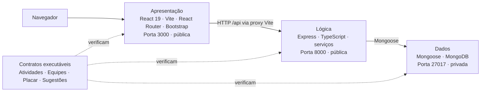

# Arquitetura do OctoFit Tracker

O OctoFit Tracker é uma aplicação de três camadas para um programa de atividades físicas escolar. O código inicial inclui contratos de API e pontos de implementação intencionalmente incompletos para que você use o modo agent do GitHub Copilot em um ciclo guiado por testes.

## Limites entre as camadas

- **Camada de apresentação**: React 19, Vite, React Router, Bootstrap e um cliente compartilhado da API em `octofit-tracker/frontend/src`.
- **Camada de lógica**: rotas e serviços Express com TypeScript em `octofit-tracker/backend/src` expõem o comportamento `/api/*` na porta `8000`.
- **Camada de dados**: modelos Mongoose e dados de demonstração em `octofit-tracker/backend/src/models` e `src/scripts/seed.ts` são persistidos no MongoDB na porta `27017`.

## Portas e regras de ambiente

- MongoDB: `27017` (privada)
- API Express: `8000` (pública)
- Interface Vite: `3000` (pública)
- O navegador acessa caminhos relativos `/api`. O Vite os encaminha para `http://localhost:8000`; `VITE_API_BASE_URL` pode substituir a URL-base.
- Não encaminhe nem torne públicas outras portas.

## Contrato da API

| Capacidade | Método e caminho | Comportamento esperado |
| --- | --- | --- |
| Registro de atividades | `GET /api/activities`, `POST /api/activities` | Lista e cria atividades válidas. POST recebe `userId`, `teamId`, `type` e `minutes`; `userId` e `teamId` devem ser IDs bem-formados de uma pessoa e uma equipe existentes, caso contrário a API retorna um 4xx intencional (nunca um 500 causado por erro de conversão). Uma atividade criada armazena `user`, `team`, `type` e `minutes` enviados, além de `points` e `occurredAt` calculados. |
| Equipes | `GET /api/teams`, `POST /api/teams` | Lista e cria equipes com integrantes. As equipes criadas e listadas mantêm os valores enviados em `name` e `mascot`. Rejeita uma equipe sem nome com `400`. |
| Placar | `GET /api/leaderboard` | Retorna as equipes ordenadas pela soma dos pontos de suas atividades, da maior para a menor. Cada item contém `teamName`, `totalPoints` e uma `rank` iniciada em 1. |
| Sugestões de treino | `GET /api/workouts/suggestions/:userEmail` | Recomenda treinos com base nos padrões de atividade recentes da pessoa correspondente ao e-mail seed. O foco da primeira sugestão (`focus`) corresponde à meta ou à atividade recente dessa pessoa, e o campo `reason` explica o motivo. Um e-mail sem pessoa correspondente retorna um 4xx intencional (por exemplo, `404`). |

## Decisões de implementação

- Decisão da camada de apresentação: cada tela consome a API pelo cliente compartilhado, renderiza dados e estados de carregamento, vazio e erro, e não acessa o banco diretamente. Mensagens e estados de erro devem ser acessíveis.
- Decisão da camada de lógica: manter rotas Express finas e concentrar validação e regras de negócio nos serviços. Entradas inválidas, IDs malformados ou referências inexistentes devem produzir respostas 4xx intencionais, nunca erros 500 de conversão ou validação.
- Decisão da camada de dados: declarar nos modelos Mongoose os campos obrigatórios, tipos, valores permitidos e defaults exigidos pelos contratos. Manter as referências entre pessoas, equipes e atividades. O seed deve ser idempotente e preservar registros não relacionados, usando modelos e código da aplicação.
- Abordagem para registro de atividades: validar tipo e minutos, verificar que os IDs de pessoa e equipe são válidos e correspondem a documentos existentes, calcular pontos e data, e persistir as referências e os valores calculados.
- Abordagem para gerenciamento de equipes: exigir nome e mascote, usar lista vazia como default de integrantes e preservar nome, mascote e integrantes na criação e listagem.
- Abordagem para o placar: somar pontos das atividades por equipe, ordenar do maior total para o menor e atribuir posições iniciadas em 1.
- Abordagem para sugestões de treino: localizar a pessoa pelo e-mail, usar a meta e atividades recentes para selecionar treinos compatíveis e explicar a recomendação em `reason`; responder com 4xx quando a pessoa não existir.

## Plano de testes

### Últimos resultados observados (2026-11-19)

- `npm test --prefix octofit-tracker/backend`: **8 falhas e 1 aprovação em 9 testes**.
    - Dados: falharam `exige identidade e metas significativas para as pessoas usuárias`, `exige nome, mascote e lista de integrantes nas equipes`, `exige que as atividades relacionem pessoas, equipes, tipos, minutos, pontos e datas` e `define sugestões de treino com foco, duração e dificuldade`. Os schemas ainda não aplicam as validações requeridas. O teste de seed idempotente passou.
    - API: falharam `cria e lista atividades válidas e rejeita entradas inválidas` e `cria equipes e disponibiliza seus integrantes` porque as operações ainda retornam 501; `ordena o placar pela pontuação total` porque o serviço retorna uma lista vazia; e `sugere treinos compatíveis com o padrão de atividade de cada pessoa` porque a sugestão não inclui a justificativa esperada.
- `npm test --prefix octofit-tracker/frontend`: **15 falhas**.
    - Falharam `exibe dados de atividades retornados pela API`, `exibe equipes, placar e sugestões de treino com conteúdo acessível` e `solicita sugestões de treino para uma pessoa específica`.
    - Para cada uma das rotas `/activities`, `/teams`, `/leaderboard` e `/workouts`, falharam `anuncia o carregamento enquanto aguarda a API`, `exibe um estado vazio significativo` e `anuncia falhas da API em um alerta acessível`. As telas ainda exibem placeholders e não implementam o consumo e os estados da API.
- Os comandos de compilação abaixo ainda não foram executados; não há resultado de build registrado.

### Próxima ordem de verificação

1. `npm run test:data --prefix octofit-tracker/backend`: validar campos obrigatórios, defaults, referências e seed idempotente.
2. `npm run test:api --prefix octofit-tracker/backend`: validar contratos de criação/listagem, respostas 4xx, placar e recomendações após corrigir os modelos.
3. `npm test --prefix octofit-tracker/frontend`: validar consumo da API e estados de carregamento, vazio e erro nas quatro telas.
4. `npm run build --prefix octofit-tracker/backend` e `npm run build --prefix octofit-tracker/frontend`: verificar compilação de ambas as aplicações após os testes focados passarem.
